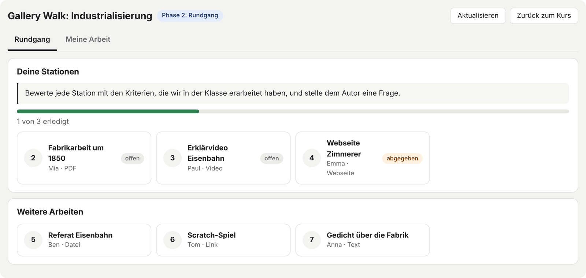
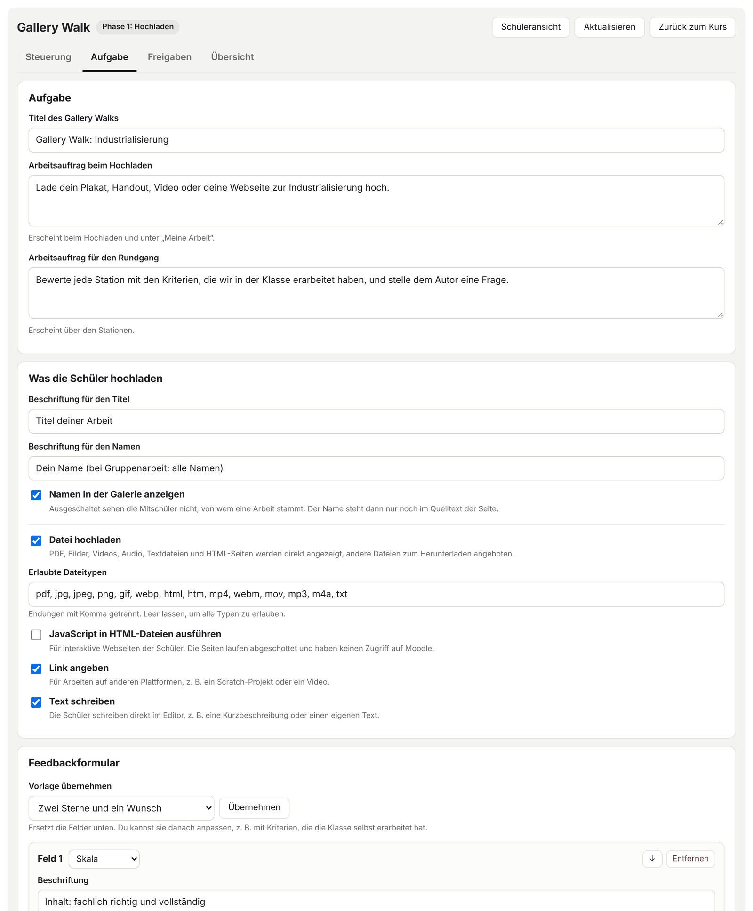
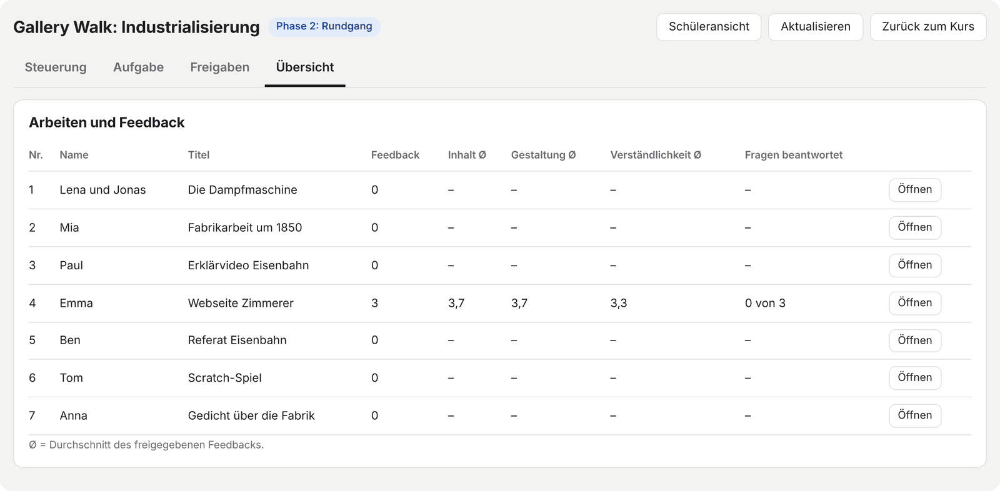
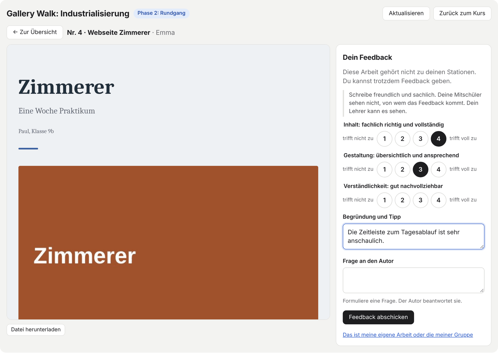
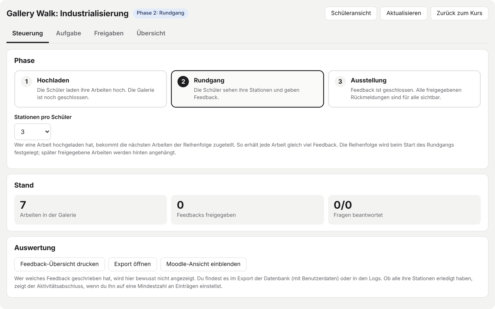
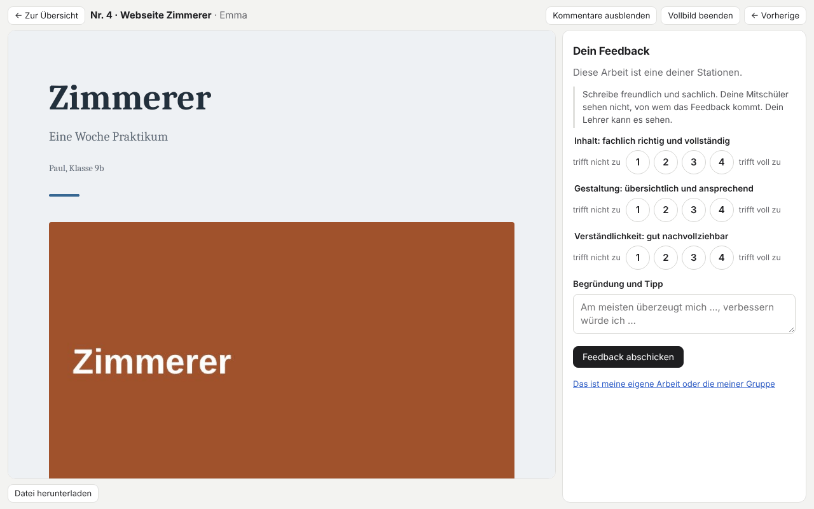
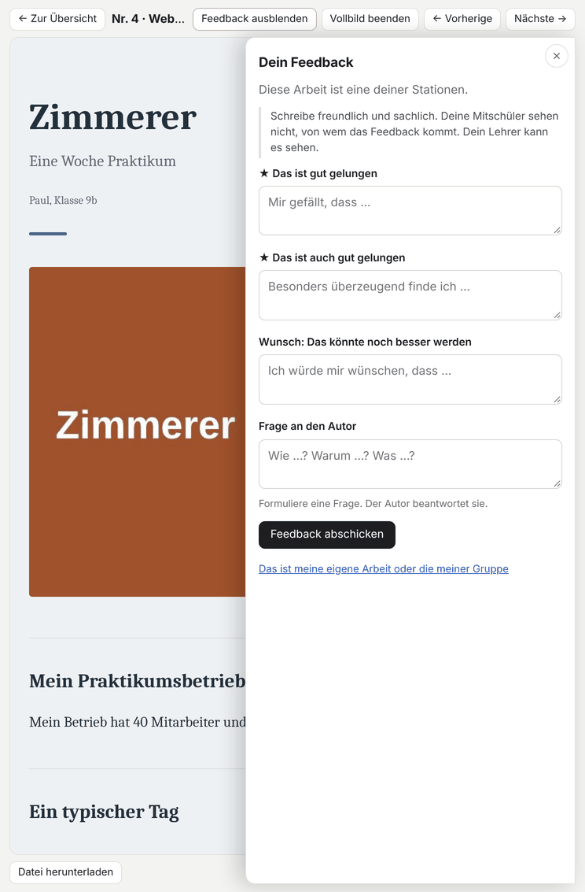
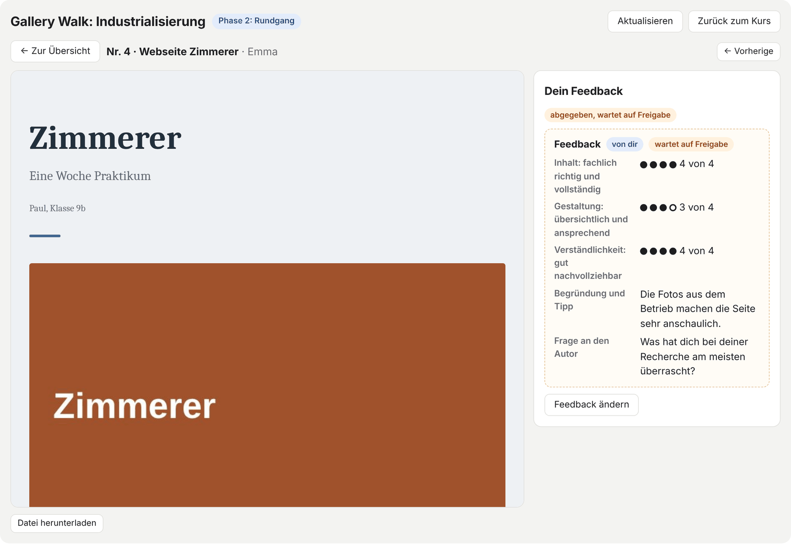
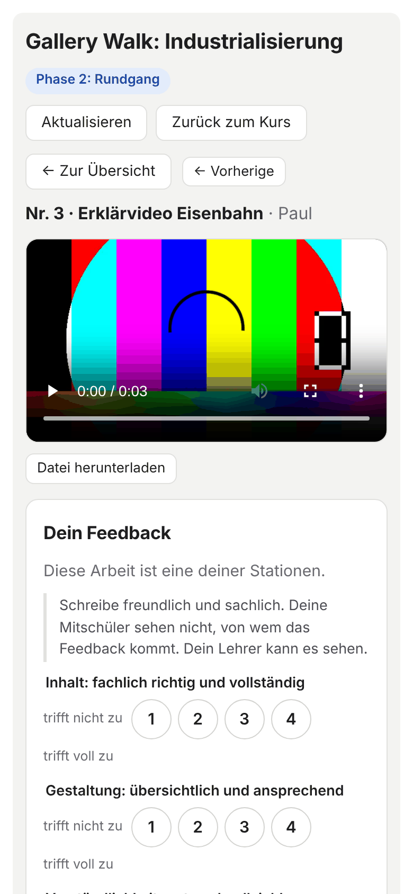

# Gallery Walk für Moodle

Ein digitaler Galerierundgang mit Peer-Feedback, gebaut als Vorlagensatz (Preset) für die Moodle-Aktivität **Datenbank**. Ohne Plugin, ohne Administratorrechte, ohne externe Dienste.

**Version 1.0** · 

Die Schüler laden ihre Arbeiten hoch: Plakate, PDFs, Videos, Webseiten, Texte oder Links. Im Rundgang bekommt jeder Schüler feste Stationen zugeteilt und gibt Feedback nach einem Formular, das der Lehrer selbst festlegt. Der Lehrer steuert die Phasen, gibt Arbeiten und Feedback frei und sieht in einer Übersicht, wie viel Feedback jede Arbeit bekommen hat.

---

## Inhalt

- [Funktionen](#funktionen)
- [Ablauf in drei Phasen](#ablauf-in-drei-phasen)
- [Installation](#installation)
- [Einrichtung im Kurs](#einrichtung-im-kurs)
- [Bedienung](#bedienung)
- [Unterstützte Dateitypen](#unterstützte-dateitypen)
- [Datenschutz und Sicherheit](#datenschutz-und-sicherheit)
- [So funktioniert es technisch](#so-funktioniert-es-technisch)
- [Bekannte Einschränkungen](#bekannte-einschränkungen)
- [Dateien in diesem Repository](#dateien-in-diesem-repository)

---

## Funktionen

**Für die Schüler**
- Arbeit hochladen als Datei, Link oder selbst geschriebener Text (vom Lehrer einstellbar)
- Feste Stationen im Rotationsprinzip, damit jede Arbeit gleich viel Feedback bekommt
- Fortschrittsanzeige: „2 von 3 erledigt“
- Die Arbeiten werden direkt in der Galerie angezeigt, auch auf dem Handy
- Vollbildmodus zum Kommentieren: Arbeit und Feedback-Leiste füllen den ganzen Bildschirm
- Feedback-Leiste jederzeit ausblendbar, damit die Arbeit die volle Breite bekommt
- Feedback mit Textfeldern und Skalen, Pflichtfelder werden geprüft
- Der Autor beantwortet die Frage aus dem Feedback
- Gruppenarbeit: Eine eigene Gruppenarbeit lässt sich überspringen

**Für den Lehrer**
- Drei Phasen per Klick: Hochladen, Rundgang, Ausstellung
- Aufgabe und Feedbackformular direkt in der Galerie einstellen, ohne Vorlagen zu bearbeiten
- Fünf Feedbackvorlagen zum Übernehmen und Anpassen
- Freigabe von Arbeiten, Feedback und Antworten, einzeln oder gesammelt
- Übersicht mit Anzahl der Rückmeldungen, Durchschnittswerten der Skalen und beantworteten Fragen
- Druckansicht mit dem gesamten Feedback, eine Seite pro Arbeit
- Schüleransicht als Vorschau

| Aufgabe einstellen | Übersicht |
|---|---|
|  |  |

---

## Ablauf in drei Phasen

| Phase | Was passiert |
|---|---|
| **1 Hochladen** | Die Schüler laden ihre Arbeiten hoch. Der Lehrer sieht sich jede Arbeit an und gibt sie frei. Die Galerie ist für die Schüler noch geschlossen. |
| **2 Rundgang** | Jeder Schüler sieht seine Stationen und gibt Feedback. Weitere Arbeiten kann er freiwillig bewerten. Der Autor sieht das freigegebene Feedback zu seiner Arbeit und beantwortet die Fragen. |
| **3 Ausstellung** | Feedback ist geschlossen. Alle sehen jede Arbeit zusammen mit dem freigegebenen Feedback, den Durchschnittswerten und den Antworten. |

**Zuteilung der Stationen:** Beim Start des Rundgangs wird die Reihenfolge der Arbeiten festgelegt. Wer Arbeit Nr. 4 hochgeladen hat, bekommt die Nummern 5, 6 und 7. So erhält jede Arbeit gleich viele Rückmeldungen. Schüler ohne eigene Arbeit bekommen einen festen Startpunkt, der aus ihrem Moodle-Konto berechnet wird. Die Anzahl der Stationen ist einstellbar.

---

## Installation

Es gibt zwei Wege. Der erste ist der einfachste.

### Weg 1: Preset importieren (empfohlen)

1. Im Kurs eine neue Aktivität **Datenbank** anlegen.
2. In der Datenbank auf **Presets** gehen und **Importieren** wählen.
3. Die Datei [`Gallery-Walk-preset.zip`](Gallery-Walk-preset.zip) hochladen und anwenden.

Der Import legt alle Felder und Vorlagen an.

### Weg 2: Felder und Vorlagen einzeln anlegen

Dieser Weg ist nützlich, wenn du die Vorlagen in eine bestehende Datenbank übernehmen oder einzelne Dateien austauschen möchtest. Alle Dateien liegen im Ordner [`vorlagen/`](vorlagen/).

**Schritt 1: Felder anlegen.** Die Namen müssen genau so lauten:

| Feldname | Feldtyp | Hinweis |
|---|---|---|
| `Typ` | Text | |
| `Titel` | Text | |
| `Name` | Text | |
| `Datei` | Datei | maximale Größe nach Bedarf, z. B. 50 MB für Videos |
| `Link` | Text | |
| `Text` | Textbereich | |
| `Bezug` | Text | |
| `F1` bis `F6` | Text | sechs einzelne Felder: `F1`, `F2`, `F3`, `F4`, `F5`, `F6` |
| `Antwort` | Text | |
| `Einstellung` | Text | |

Kein Feld als Pflichtfeld markieren.

**Schritt 2: Vorlagen einfügen.** Den Inhalt jeder Datei in die passende Vorlage kopieren. Die Bezeichnungen können je nach Moodle-Version leicht abweichen.

| Datei | Vorlage in Moodle |
|---|---|
| [`listtemplateheader.html`](vorlagen/listtemplateheader.html) | Listenansicht, Kopfbereich |
| [`listtemplate.html`](vorlagen/listtemplate.html) | Listenansicht, wiederholter Eintrag |
| [`listtemplatefooter.html`](vorlagen/listtemplatefooter.html) | Listenansicht, Fußbereich |
| [`singletemplate.html`](vorlagen/singletemplate.html) | Einzelansicht |
| [`addtemplate.html`](vorlagen/addtemplate.html) | Eintrag hinzufügen |
| [`csstemplate.css`](vorlagen/csstemplate.css) | CSS |
| [`jstemplate.js`](vorlagen/jstemplate.js) | JavaScript |
| `asearchtemplate.html`, `rsstemplate.html`, `rsstitletemplate.html` | bleiben leer |

**Wichtig:** Beim Einfügen in die Vorlagen den Editor auf HTML-Quelltext umstellen bzw. den WYSIWYG-Editor für Vorlagen ausschalten. Sonst verändert der Editor die Vorlagen.

Die Datei [`preset.xml`](vorlagen/preset.xml) beschreibt Felder und Einstellungen. Sie wird nur für den Import als Preset gebraucht.

---

## Einrichtung im Kurs

1. **Einstellungen der Datenbank-Aktivität öffnen:**
   - **„Freigabe erforderlich“ auf Ja stellen.** Dann siehst du neue Arbeiten, Feedback und Antworten zuerst allein und gibst sie frei. Beim Preset-Import wird diese Einstellung nur übernommen, wenn du die Einstellungen überschreiben lässt.
   - **„Bearbeiten freigegebener Einträge erlauben“ auf Ja lassen.** Das ist die Voreinstellung. Die Galerie erkennt eigene Einträge daran, dass Moodle einen Bearbeiten-Link anzeigt. Steht diese Einstellung auf Nein, erkennen Schüler ihre Einträge nach der Freigabe nicht mehr.
2. **Dateigröße prüfen:** Das Datei-Feld erlaubt bis zu 50 MB. Mehr als die maximale Dateigröße des Kurses ist nicht möglich.
3. **Button „Zurück zum Kurs“:** In `jstemplate.js` (ganz oben) und in `addtemplate.html` steht der Platzhalter `LINK-ZUM-KURS`. Trage dort den Link zum Kurs ein. Bleibt der Platzhalter stehen, ermittelt die Galerie den Kurs automatisch.
4. **Aufgabe einstellen:** Datenbank öffnen, Tab **Aufgabe** wählen, Aufgabe und Feedbackformular festlegen und speichern.
5. **Optional, Aktivitätsabschluss:** Wenn du eine Mindestzahl an Einträgen verlangst, zum Beispiel 4 für 1 Arbeit und 3 Feedbacks, siehst du im Abschlussbericht, wer seine Stationen erledigt hat. Antworten auf Fragen zählen dabei mit.

Die Galerie funktioniert auch ohne „Freigabe erforderlich“. Arbeiten und Feedback sind dann sofort für alle sichtbar, und die Galerie zeigt dem Lehrer einen Hinweis.

---

## Bedienung

### Lehrer

| Tab | Inhalt |
|---|---|
| **Steuerung** | Phase umschalten, Anzahl der Stationen, Stand der Abgaben, Druckansicht, Export, Moodle-Standardansicht ein- und ausblenden |
| **Aufgabe** | Titel, Arbeitsaufträge, erlaubte Abgabeformen und Dateitypen, Feedbackformular |
| **Freigaben** | Wartende Arbeiten, Feedbacks und Antworten freigeben oder löschen |
| **Übersicht** | Tabelle aller Arbeiten mit Feedback-Anzahl, Durchschnittswerten und beantworteten Fragen |

Mit **Schüleransicht** siehst du die Galerie so, wie sie ein Schüler sieht. Absenden ist dort deaktiviert.

Mit **Vollbild** oben rechts füllt die Galerie den ganzen Bildschirm, zum Beispiel um die Übersicht oder die Ausstellung am Beamer zu zeigen. Der Vollbildmodus bleibt beim Wechsel zwischen Tabs und Arbeiten erhalten.

### Feedbackformular

Das Formular hat bis zu sechs Felder. Jedes Feld ist entweder eine **Textantwort** oder eine **Skala** mit 2 bis 10 Stufen und Beschriftung an beiden Enden. Ein Textfeld kann als **Frage an den Autor** markiert werden: Der Autor beantwortet es, und die Galerie verlangt ein Fragezeichen.

Vorlagen zum Übernehmen:

| Vorlage | Felder |
|---|---|
| Zwei Sterne und ein Wunsch | zwei Stärken, ein Wunsch, eine Frage an den Autor |
| Kriterien mit Skala | Inhalt, Gestaltung, Verständlichkeit (je 1–4), Begründung und Tipp |
| Ich sehe – ich denke – ich frage mich | drei Textfelder, das letzte als Frage an den Autor |
| Plus – Minus – Interessant | drei Textfelder |
| Freier Kommentar | ein Textfeld |

Die Kriterien lassen sich beliebig ersetzen, zum Beispiel durch Kriterien, die die Klasse selbst erarbeitet hat.

**Achtung:** Das Feedback wird nach der Position der Felder gespeichert. Wenn es schon Feedback gibt, solltest du keine Felder mehr hinzufügen, löschen oder verschieben. Die Galerie warnt in diesem Fall. Beschriftungen zu ändern ist unproblematisch.

### Schüler

| Tab | Inhalt |
|---|---|
| **Meine Arbeit** | Arbeit hochladen oder bearbeiten, Freigabestatus, erhaltenes Feedback, Fragen beantworten |
| **Rundgang** (Phase 2) | eigene Stationen mit Fortschritt, weitere Arbeiten |
| **Ausstellung** (Phase 3) | alle Arbeiten mit Feedback und Antworten |

**Vollbild:** Der Button „Vollbild“ steht oben rechts und in der Ansicht jeder Arbeit. Öffnet man im Vollbildmodus eine Arbeit, füllt sie den ganzen Bildschirm.
- Im Querformat steht die Feedback-Leiste rechts daneben.
- Auf Tablets und Handys im Hochformat bleibt die Arbeit in voller Größe. Die Feedback-Leiste ist zunächst eingeklappt und gleitet mit „Feedback einblenden“ als Schublade von rechts über die Arbeit.
- „Feedback ausblenden“ (in der Leiste über der Arbeit oder mit dem × in der Feedback-Leiste) gibt der Arbeit die volle Breite, auch ohne Vollbild. Die Einstellung bleibt beim Blättern erhalten, bereits Geschriebenes geht nicht verloren.
- Mit den Pfeiltasten oder „Vorherige“ und „Nächste“ blättert man durch die Stationen, ohne den Vollbildmodus zu verlassen.
- Esc oder „Vollbild beenden“ schließt den Modus.

| Vollbild am Computer | Schublade auf dem Tablet (hochkant) |
|---|---|
|  |  |

**Gruppenarbeit:** Ein Gruppenmitglied lädt hoch und trägt alle Namen ein. Bekommen andere Gruppenmitglieder die eigene Arbeit als Station, klicken sie auf „Das ist meine eigene Arbeit oder die meiner Gruppe“ und erhalten eine andere Station.

| Feedback abgegeben | Auf dem Handy |
|---|---|
|  |  |

---

## Unterstützte Dateitypen

Welche Typen erlaubt sind, legt der Lehrer im Tab **Aufgabe** fest.

| Typ | Endungen | Darstellung in der Galerie |
|---|---|---|
| PDF | pdf | eingebettet und auf Seitenbreite gezoomt, zusätzlich „PDF in neuem Tab öffnen“ |
| Bild | jpg, jpeg, png, gif, webp, svg, avif | direkt |
| Video | mp4, webm, mov, m4v | Videoplayer |
| Audio | mp3, m4a, wav, ogg, aac | Audioplayer |
| Webseite | html, htm | abgeschottet eingebettet, JavaScript optional |
| Text | txt, md, csv | als Text |
| Andere (z. B. docx, pptx) | | zum Herunterladen |

Zusätzlich oder statt einer Datei sind ein **Link** (öffnet in neuem Tab) und ein **Text** aus dem Moodle-Editor möglich.

Mit dem Berufe-Baukasten erstellte Seiten werden direkt angezeigt. Das Entstehungsprotokoll am Ende dieser Seiten ist für Mitschüler ausgeblendet, der Lehrer sieht es.

---

## Datenschutz und Sicherheit

- **Keine externen Dienste:** Alles läuft in der Moodle-Datenbank. Es werden keine Skripte, Schriften oder Daten von anderen Servern geladen.
- **Rechte:** Die Galerie schreibt über das normale Moodle-Formular. Moodle prüft wie gewohnt, wer welchen Eintrag sehen und bearbeiten darf.
- **Moderation:** Mit „Freigabe erforderlich“ sieht neue Einträge zuerst nur der Lehrer. Ändert ein Schüler einen freigegebenen Eintrag, muss er neu freigegeben werden. Das erledigt Moodle selbst.
- **Webseiten der Schüler** laufen in einem abgeschotteten Rahmen und haben keinen Zugriff auf die Moodle-Sitzung. JavaScript ist standardmäßig ausgeschaltet.
- **Anonymes Feedback:** Mitschüler sehen nicht, wer ein Feedback geschrieben hat. Moodle speichert den Verfasser trotzdem, der Lehrer findet ihn im Export der Datenbank (mit Benutzerdaten) und in den Logs. Die Schüler werden im Formular darauf hingewiesen. Technisch versierte Schüler könnten den Verfasser über Suchparameter der Datenbank herausfinden. Die Anonymität ist also kein absoluter Schutz.
- **Namen der Autoren** lassen sich ausblenden. Sie stehen dann aber weiterhin im Quelltext der Seite.

---

## So funktioniert es technisch

Die Galerie nutzt eine einzige Moodle-Datenbank als Speicher. Das JavaScript in der Vorlage liest die Listenansicht im Hintergrund aus und füllt zum Speichern das normale Eingabeformular aus. Für Moodle sieht das aus wie ein Schüler, der einen Eintrag anlegt.

Alle Einträge stehen in einer Tabelle. Das Feld `Typ` unterscheidet vier Arten:

| Typ | Wer legt ihn an | Inhalt |
|---|---|---|
| `Steuerung` | Lehrer, genau ein Eintrag | Phase, Aufgabe, Feedbackformular, Reihenfolge der Stationen |
| `Exponat` | Schüler | eine Arbeit mit Titel, Name, Datei, Link oder Text |
| `Feedback` | Schüler | Antworten im Feedbackformular in `F1` bis `F6` |
| `Antwort` | Autor der Arbeit | Antwort auf die Frage in einem Feedback |

Über das Feld `Bezug` hängen die Einträge zusammen. Ein Feedback verweist auf die Nummer der Arbeit, eine Antwort auf die Nummer des Feedbacks.

Weitere Details:
- **Vorlagen:** Die Listenvorlage legt die Felder jedes Eintrags in einen unsichtbaren Bereich der Seite. Daraus liest das Programm.
- **Zuteilung:** Die Zuteilung der Stationen wird nicht gespeichert. Gespeichert ist nur die Reihenfolge der Arbeiten, jeder Browser berechnet seine Stationen daraus selbst.
- **Einstellungen:** Die Einstellungen stehen kodiert im Feld `Einstellung` (beginnt mit `cfg:`). So kann Moodle sie beim Anzeigen nicht verändern, zum Beispiel durch Text-Filter.
- **Eigene Einträge:** Die Galerie erkennt eigene Einträge daran, dass Moodle dort einen Bearbeiten-Link anzeigt.

---

## Bekannte Einschränkungen

- **Kein Live-System:** Die Schüleransicht aktualisiert sich alle 90 Sekunden, die Lehreransicht alle 30 Sekunden. Jederzeit geht es auch über „Aktualisieren“.
- **Leistung:** Jeder Abruf lädt die komplette Listenansicht. Für eine Klasse ist das unproblematisch, für mehrere hundert gleichzeitige Nutzer nicht gedacht.
- **PDF-Darstellung:** PDFs zeigt der eingebaute PDF-Betrachter des Browsers an. Die Galerie bittet ihn, auf Seitenbreite zu zoomen und keine Seitenleiste einzublenden. Chrome, Edge und Firefox übernehmen das, Safari zeigt PDFs ohnehin auf Seitenbreite. Ändert sich die Breite (Vollbild, Feedback-Leiste, Drehen des Geräts), lädt die Galerie das PDF neu, damit der Zoom wieder passt. Es steht danach wieder auf Seite 1.
- **PDF auf dem iPad:** Safari zeigt eingebettete PDFs manchmal nur teilweise an. Dafür gibt es „PDF in neuem Tab öffnen“.
- **PowerPoint und Word** können Browser nicht anzeigen. Am besten lässt du Präsentationen und Dokumente als PDF hochladen und nimmst pptx und docx nicht in die erlaubten Dateitypen auf.
- **Vollbild auf dem iPhone:** Safari erlaubt auf dem iPhone kein echtes Vollbild für Webseiten. Die Galerie füllt dann das Browserfenster, die Adressleiste bleibt sichtbar.
- **HEIC-Fotos vom iPhone** können die meisten Browser nicht anzeigen. Die Galerie bietet sie zum Herunterladen an. Besser als JPG hochladen lassen.
- **Zwischenspeicher:** Moodle speichert die JavaScript-Vorlage bis zu 10 Minuten zwischen. Änderungen an den Vorlagen erscheinen deshalb mit Verzögerung.
- **Gruppenmodus:** Bei „Getrennte Gruppen“ sieht jede Gruppe nur ihre eigenen Arbeiten, und Schüler ohne Gruppe können keine Einträge anlegen.
- **Getestete Version:** Die Galerie ist für Moodle 4.1 und neuer gedacht. Entwickelt wurde sie mit einer Simulation, die das Verhalten von Moodle 4.5 nach dessen Quellcode nachbildet. Erste Tests in einer echten Moodle-Installation sind erfolgt. Rückmeldungen aus weiteren Installationen sind willkommen.

---

## Hintergrund

Die Technik, eine Moodle-Datenbank per JavaScript als Speicher für eine interaktive Anwendung zu nutzen, ist angelehnt an das Live-Quiz [By-Catch](https://github.com/ChristianAugsburg/By-Catch).

Vielen Dank an Christian fürs Reviewen und die Anregungen!
